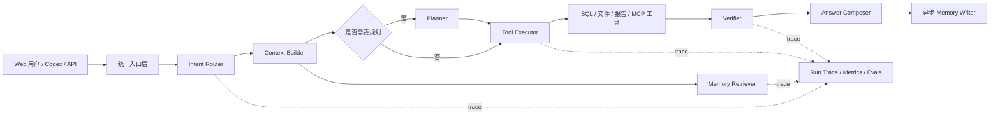

# Data Agent Agent 能力演进与工程实施 RFC

- 状态：Draft
- 日期：2026-09-18
- 范围：Agent 编排、意图识别、Memory、MCP、评测与可观测性
- 目标读者：产品、后端、前端、数据与测试开发人员

## 1. 摘要

Data Agent 已经具备数据文件与 PostgreSQL 分析、只读 SQL 防护、工具调用、报告生成、对话压缩、长期 Memory、运行追踪、评测以及 Streamable HTTP MCP 接入能力。下一阶段不应继续平铺功能，而应将已有能力收敛为一条可路由、可验证、可追踪、可评测、可回滚的统一 Agent 执行链。

推荐目标架构为：

```text
入口 → 意图识别 → 上下文组装 → 条件式规划 → 工具执行 → 结果验证 → 回答 → 异步 Memory 写入
```

Web、内部 API、Eval 和 MCP 必须复用同一个 Orchestrator，避免不同入口出现行为差异。实施顺序建议为：

1. 建立现状基线和评测集。
2. 引入可观测的意图路由，但先以 Shadow Mode 运行。
3. 将 Memory 从全量注入升级为分类、检索、冲突处理和生命周期管理。
4. 拆分当前 Agent 循环，建立统一 Orchestrator、Executor 和 Verifier。
5. 强化 MCP 协议兼容、权限、Token 撤销、限流和审计。
6. 通过 Feature Flag、双路径对比和灰度发布逐步切换。

## 2. 背景与现状

### 2.1 当前已有能力

| 能力 | 当前实现 |
| --- | --- |
| Agent 工具循环 | [`backend/app/services/agent.py`](../../backend/app/services/agent.py) |
| 工具定义与执行 | `TOOL_DEFINITIONS` 与 `_execute_tool` |
| 对话恢复与压缩 | [`backend/app/services/conversation.py`](../../backend/app/services/conversation.py)、[`memory_manager.py`](../../backend/app/services/memory_manager.py) |
| 长期 Memory 提取 | `extract_memories`、Memory 管理接口 |
| MCP Server | [`backend/app/services/mcp.py`](../../backend/app/services/mcp.py)、`POST /mcp` |
| MCP 鉴权 | 带 `aud=mcp` 的 Bearer JWT |
| 运行追踪 | [`backend/app/services/runs.py`](../../backend/app/services/runs.py) |
| Agent Eval | [`backend/app/services/evals.py`](../../backend/app/services/evals.py) |
| SQL 安全 | 单条只读 `SELECT`/`WITH`、只读事务与行数限制 |

当前 MCP 使用 Streamable HTTP：Codex 连接已经运行的 `http://localhost:8000/mcp`。它不是 stdio 模式；Codex 不负责启动整个 Data Agent 服务。

### 2.2 当前主要问题

1. 所有请求直接进入同一个模型工具循环，缺少独立的意图路由和风险分级。
2. `agent.py` 同时承担提示词、上下文组装、规划、工具分发、执行和回答，职责过重。
3. 长期 Memory 采用全量注入，数量增长后容易产生噪声、冲突和上下文浪费。
4. `memory.py` 与 `memory_manager.py` 存在两套提取与压缩逻辑，需要收敛。
5. 当前计划是静态模板，无法区分简单查询与复杂多步分析。
6. Verifier 主要检查是否产生查询证据，尚未全面验证结论与证据是否一致。
7. MCP 为轻量手写实现，协议覆盖、错误语义、Token 撤销、权限范围和限流仍需加强。
8. Eval 已覆盖部分 SQL 正确性，但尚未系统覆盖意图、Memory、MCP 和安全回归。

## 3. 目标与非目标

### 3.1 目标

- 对用户请求进行稳定、可解释、可评测的意图识别。
- 简单请求走短路径，复杂请求才启用 Planner 和多步工具循环。
- Memory 只注入与当前任务相关、有效且允许使用的内容。
- 每条数据结论能够追踪到查询、工具输出或业务定义。
- Web、API、Eval 和 MCP 共用相同的应用服务与 Agent 行为。
- 所有路由、工具、验证和 Memory 决策具备结构化追踪。
- 新旧链路可以并行运行、对比、灰度和回滚。
- 在不降低安全性的前提下减少无效工具调用、Token 和整体延迟。

### 3.2 非目标

- 第一阶段不引入复杂多 Agent 或自治 Agent 团队。
- 第一阶段不开放业务数据库写入能力。
- 第一阶段不强制引入向量数据库。
- 不为了框架迁移而替换现有稳定的数据访问和 SQL Guard。
- 不保存模型隐藏推理过程，只保存结构化决策、计划、工具调用和验证结果。
- 不一次性重写全部 Agent 代码。

## 4. 设计原则

1. **评测先于重构**：没有基线就无法证明改造有效。
2. **最小权限**：工具只获得完成任务所需的资源与权限。
3. **证据优先**：数据结论必须能追踪到查询结果或明确业务定义。
4. **单一执行内核**：所有入口复用同一个 Orchestrator。
5. **简单任务走短路径**：避免为普通帮助或资源枚举启动完整 Agent 循环。
6. **复杂任务条件式规划**：Planner 不是每次请求的固定步骤。
7. **Memory 可治理**：可查看、修改、删除、失效、追踪来源和处理冲突。
8. **模型输出不可信**：路由、工具参数、SQL、报告块和 Memory 都需结构化校验。
9. **渐进式发布**：Shadow Mode、Feature Flag、灰度、回滚缺一不可。
10. **协议边界稳定**：MCP 暴露稳定业务能力，而非内部函数或数据库细节。

## 5. 目标架构



### 5.1 统一请求生命周期

1. 入口层完成用户身份、资源归属和请求 Schema 校验。
2. Intent Router 输出结构化意图、置信度、资源需求和风险等级。
3. Context Builder 按需加载文件 Schema、数据库 Schema、业务文档和 Memory。
4. 简单请求直接执行；复杂请求生成受约束的计划。
5. Executor 在预算内调用工具，并区分可重试、需澄清和不可恢复错误。
6. Verifier 检查查询证据、工具错误、报告完整性和结论一致性。
7. Answer Composer 生成带证据和限制说明的回答。
8. Memory Writer 异步提取长期有效信息，经过过滤、去重和冲突处理后写入。
9. 全过程写入 AgentRun、AgentStep 和评测指标。

## 6. 意图识别设计

### 6.1 建议意图集合

```python
IntentName = Literal[
    "data_query",
    "schema_exploration",
    "data_quality",
    "report_generation",
    "memory_command",
    "resource_management",
    "help_or_chat",
    "unsafe_request",
]
```

建议结构化输出：

```python
class IntentDecision(BaseModel):
    intent: IntentName
    confidence: float
    requires_data: bool
    requires_clarification: bool
    resource_hints: list[str]
    suggested_workflow: str
    risk_level: Literal["low", "medium", "high"]
```

### 6.2 两级识别策略

第一层使用确定性规则处理明确请求：

- “列出文件/连接” → `resource_management`
- “记住/忘记/删除记忆” → `memory_command`
- “生成报告” → `report_generation`
- 明确写库、删除或危险 SQL → `unsafe_request`

第二层只在规则无法确定时调用模型，并要求结构化 JSON 输出。

### 6.3 路由策略

| 意图 | 推荐路径 |
| --- | --- |
| `help_or_chat` | 不加载数据库 Schema，不进入 SQL Agent |
| `resource_management` | 直接调用资源服务 |
| `schema_exploration` | 仅开放资源枚举与 Schema 检查工具 |
| `data_query` | Inspect → SQL → Verifier |
| `data_quality` | Profile → SQL → Data Quality Verifier |
| `report_generation` | 查询证据 → 报告生成 → 报告验证 |
| `memory_command` | 直接调用 Memory Service |
| `unsafe_request` | 拒绝、降级或请求人工确认 |

低置信度或缺少资源时应进入 `clarify`，而不是猜测。

### 6.4 发布方法

Intent Router 第一阶段只以 Shadow Mode 运行：记录它的预测，但不改变现有执行路径。达到目标准确率后，再通过 Feature Flag 启用真实路由。

## 7. Memory 设计

### 7.1 四类 Memory

| 类型 | 内容 | 生命周期 |
| --- | --- | --- |
| Working Memory | 当前对话、工具结果、临时状态 | 当前会话 |
| Semantic Memory | 用户偏好、业务定义、指标口径 | 长期 |
| Episodic Memory | 历史分析任务、结论、证据与后续动作 | 中期 |
| Procedural Memory | 分析方法、Skill、工作流 | 版本化长期 |

### 7.2 生命周期

```text
提取 → 敏感信息过滤 → 标准化 → 去重 → 冲突判断 → 存储
                                                     ↓
回答 ← Top-K 注入 ← 相关性排序 ← 权限/有效期/Scope 过滤
                                                     ↓
                                        使用反馈 / 衰减 / 删除
```

### 7.3 推荐数据字段

在现有 `Memory` 基础上逐步增加：

```text
kind
scope
confidence
importance
fingerprint
source_type
source_run_id
valid_from
valid_until
last_used_at
usage_count
metadata
```

### 7.4 检索策略

第一版不必立即引入向量数据库，可以使用：

```text
用户隔离 + Scope 过滤 + 类别过滤 + 关键词匹配 + 最近使用时间 + importance
```

数据规模和语义检索需求增长后，再评估 PostgreSQL `pgvector`。每次回答建议最多注入 5～10 条 Memory，并记录实际使用的 Memory ID。

### 7.5 安全规则

- 不保存密码、API Key、Token、连接字符串。
- 不保存原始数据行和一次性查询结果。
- 不将模型输出直接作为可信 Memory。
- 冲突内容必须 supersede 或进入人工确认。
- 用户可以关闭自动 Memory，并查看、修改和删除已有内容。
- Memory 的读取仍必须经过用户和 Workspace Scope 校验。

## 8. Agent 编排重构

建议将当前 `agent.py` 逐步拆分为：

```text
backend/app/services/agent/
  intent.py
  context_builder.py
  planner.py
  tool_registry.py
  executor.py
  verifier.py
  answer.py
  orchestrator.py
```

### 8.1 Planner

- 简单请求不生成计划。
- 复杂请求生成短计划，步骤数量和工具范围受限。
- Planner 只能引用已经注册的工具和允许访问的资源。
- 计划变更必须记录原因，但不保存隐藏推理。

### 8.2 Executor

Executor 负责：

- 工具参数 Schema 校验。
- 单次和全局超时。
- 最大工具调用数、Token 和成本预算。
- 可重试错误的有限次数恢复。
- 写操作或高风险操作的审批边界。
- 工具输出大小和敏感字段过滤。

建议错误分类：

```text
retryable
clarification_required
permission_denied
invalid_input
resource_unavailable
policy_violation
internal_error
```

### 8.3 Verifier

Verifier 不仅检查“是否执行了 SQL”，还应检查：

- 结论是否能由查询结果支持。
- 是否使用了正确数据源和时间范围。
- SQL 是否与用户问题一致。
- 是否存在工具错误或未解决的重试。
- 报告是否包含叙述、证据、限制和后续建议。
- 回答是否包含未经工具验证的确定性数据断言。

## 9. MCP 演进设计

### 9.1 定位

MCP 层负责发布稳定工具定义、接收工具调用并返回结果。它是协议适配层，不应复制 Agent 业务逻辑。Web 和 MCP 都应调用统一 Orchestrator 或 Application Service。

### 9.2 工具层次

保留两类能力：

- 高层委托工具：`ask_data_agent`
- 原子工具：`list_resources`、`inspect_schema`、`execute_sql`、报告工具

不要把每个内部函数或 REST Endpoint 都暴露成 MCP 工具。

### 9.3 工具契约

- 输入 Schema 设置 `additionalProperties: false`。
- 为稳定工具定义结构化输出 Schema。
- 工具名称和描述说明使用条件、限制和副作用。
- 区分只读工具与写工具。
- 统一错误码：

```text
RESOURCE_NOT_FOUND
PERMISSION_DENIED
INVALID_SQL
QUERY_TIMEOUT
CLARIFICATION_REQUIRED
RATE_LIMITED
INTERNAL_ERROR
```

### 9.4 鉴权与授权

当前 Bearer JWT 已提供基础身份认证和用户隔离。后续建议增加：

```text
jti
scope
issued_at
token_version
```

并实现：

- 单 Token 撤销与轮换。
- Token 列表和最后使用时间。
- 工具级 Scope，例如 `data:read`、`sql:execute`、`reports:write`。
- 用户级和 Token 级限流。
- MCP 调用审计日志。
- 外网部署时强制 HTTPS。

### 9.5 协议实现

当前手写的 `initialize`、`tools/list` 和 `tools/call` 可以继续作为兼容基线。后续可评估采用 MCP SDK/FastMCP，以减少协议版本、Session、通知和错误语义维护成本。

## 10. Eval 与可观测性

### 10.1 评测集

第一批建议建立 50～100 个固定用例：

- 意图识别
- Schema 探索
- 单步查询
- 多步分析
- 数据质量
- 报告生成
- Memory 写入与检索
- MCP 与 Web 一致性
- 越权、恶意 SQL 和敏感信息
- 超时、失败和恢复

示例：

```yaml
name: top_customers
input: 找出销售额最高的十个客户
expected_intent: data_query
expected_tools:
  - inspect_file
  - execute_sql
forbidden_tools:
  - create_report
expected_result_sql: reference/top_customers.sql
max_tool_calls: 4
requires_evidence: true
```

### 10.2 指标

| 维度 | 指标 |
| --- | --- |
| 正确性 | SQL 结果一致率、答案正确率、报告完整率 |
| 路由 | Intent 准确率、低置信度澄清率 |
| Memory | 写入精确率、检索命中率、误召回率、冲突率 |
| 工具 | 工具选择准确率、平均调用数、失败与重试次数 |
| 性能 | P50/P95 延迟、输入/输出 Token、单请求成本 |
| 安全 | 越权数、危险 SQL 数、敏感信息泄露数 |
| 稳定性 | 超时率、恢复成功率、MCP 初始化失败率 |

### 10.3 Trace

建议为每次请求记录：

```text
intent_decision
context_resources
retrieved_memory_ids
plan
tool_calls
tool_errors
evidence_query_ids
verifier_result
token_usage
latency
feature_flags
```

不得记录密码、Token、连接字符串或模型隐藏推理。

## 11. 标准工程实施流程

### 11.1 文档结构

```text
docs/agent-evolution/
  data-agent-evolution-rfc.md
  current-state.md
  evaluation-plan.md
  roadmap.md
  adr/
    0001-project-goal-harness-capability.md
    0002-use-single-orchestrator.md
    0003-intent-routing-strategy.md
    0004-memory-taxonomy.md
    0005-memory-retrieval-strategy.md
    0006-mcp-sdk-and-transport.md
    0007-agent-evaluation-gates.md
  specs/
    intent-router.md
    memory-v2.md
    orchestrator-v2.md
    mcp-v2.md
```

RFC 描述总体目标和边界；ADR 记录重大选择及其原因；Spec 描述某一阶段的具体接口、数据模型和测试。

### 11.2 开发流程

```text
RFC 评审
  → ADR 决策
  → Eval 与验收标准
  → Issue 拆分
  → 小型 PR
  → 自动化测试
  → Shadow/双路径验证
  → 灰度发布
  → 指标观察
  → 全量或回滚
```

### 11.3 分支建议

```text
feature/intent-router
feature/memory-retrieval
refactor/agent-orchestrator
feature/mcp-v2
```

### 11.4 PR 必填信息

- 变更目标与非目标。
- 对应 RFC、ADR 或 Spec。
- API 与数据模型影响。
- 数据迁移和向后兼容性。
- 测试与 Eval 前后对比。
- 安全和隐私影响。
- Feature Flag 与回滚方法。
- 延迟、Token 和成本变化。

### 11.5 数据迁移原则

对于 Memory 等数据模型变化，采用：

```text
新增字段 → 双写 → 数据回填 → 切换读取 → 观察 → 移除旧逻辑
```

避免在单个版本中直接删除旧字段或改变旧数据语义。

## 12. 阶段 Roadmap

### Phase 0：基线与评测

交付：

- 当前架构和行为说明。
- 50 个左右的初始 Eval Case。
- 正确性、延迟、Token 和工具调用基线。
- 已知失败分类。

退出条件：当前版本能够稳定重复运行评测，并保存可比较结果。

### Phase 1：Intent Router

交付：

- `IntentDecision` Schema。
- 规则优先、模型兜底的路由器。
- Shadow Mode 和路由 Trace。
- 意图评测集。

退出条件：核心意图准确率达到预设阈值，低置信度请求能够正确澄清。

### Phase 2：Memory V2

交付：

- 四类 Memory 和统一服务。
- 去重、冲突、有效期和 Scope。
- Top-K 检索。
- Memory 使用追踪和管理 UI/API。

退出条件：敏感信息测试全部通过，误召回可控，Token 消耗相对全量注入下降。

### Phase 3：Orchestrator V2

交付：

- Context Builder、Planner、Executor、Verifier。
- 简单/复杂任务分流。
- 新旧 Agent 双路径。
- 预算、超时和错误分类。

退出条件：核心数据任务不低于旧链路准确率，同时减少无效调用或延迟。

### Phase 4：MCP V2

交付：

- 统一应用服务。
- 严格输入/输出契约。
- Token Scope、撤销、限流和审计。
- 真实 Codex 客户端端到端测试。
- MCP SDK 迁移结论。

退出条件：Web 与 MCP 结果一致，协议测试、安全测试和真实客户端测试通过。

### Phase 5：持续优化

- 扩充 Eval 数据集。
- 按失败类型优化提示词、工具和检索。
- 评估 Tool Search、程序化工具编排或多 Agent 的真实收益。
- 只有在单 Agent 架构出现明确瓶颈后才引入多 Agent。

## 13. 第一周行动清单

### 第 1 天

- 审阅本 RFC。
- 补充目标、非目标和业务成功指标。
- 绘制当前请求调用链。

### 第 2 天

- 创建 `current-state.md`。
- 运行现有测试和完整栈验证。
- 记录当前延迟、Token、工具调用和失败样本。

### 第 3 天

- 创建 `evaluation-plan.md`。
- 建立第一批 30～50 个 Eval Case。
- 固化参考 SQL 和期望工具调用。

### 第 4 天

- 评审 RFC。
- 确认第一批 ADR。
- 将未决事项明确分配负责人和截止时间。

### 第 5 天

- 将 Phase 1 拆成 Issue。
- 定义 Intent Router 的完成标准。
- 开始实现 Schema 与 Shadow Mode，不改变现有用户路径。

## 14. Definition of Done

每个阶段至少满足：

- 功能目标和非目标清晰。
- RFC/ADR/Spec 已更新并完成评审。
- 单元、集成、安全和 Eval 测试通过。
- 数据迁移可重复执行且具备回滚路径。
- 新能力位于 Feature Flag 后。
- Trace 和指标能够观察新行为。
- 无新增用户数据越权或敏感信息泄露风险。
- API 和 MCP 向后兼容，或提供明确迁移说明。
- 性能和成本变化已量化。
- 生产发布与回滚步骤可执行。

## 15. 风险与缓解

| 风险 | 缓解措施 |
| --- | --- |
| 大规模重构导致回归 | 双路径、Feature Flag、Eval Gate |
| Router 误判 | Shadow Mode、置信度阈值、clarify |
| Memory 污染 | 敏感过滤、置信度、来源追踪、用户管理 |
| Memory 上下文膨胀 | Top-K、Scope、有效期和使用衰减 |
| Planner 过度规划 | 复杂度门槛、步骤上限、简单任务短路径 |
| MCP Token 泄露 | 环境变量、撤销、轮换、Scope、HTTPS |
| 工具调用失控 | 调用预算、超时、审批和限流 |
| 指标改善但答案变差 | 正确性作为发布硬门槛，成本指标不能单独决策 |

## 16. 待决事项

1. Intent Router 是否复用主模型，还是使用更快的独立模型。
2. Memory V2 第一阶段使用关键词排序还是直接引入 `pgvector`。
3. Planner 的启用条件和最大步骤数。
4. Verifier 使用纯规则、模型验证，还是二者结合。
5. MCP 是继续轻量实现，还是在 MCP V2 阶段迁移到 FastMCP。
6. Token 撤销采用数据库 Token 表还是用户级 `token_version`。
7. Eval 的发布硬门槛和允许的性能退化范围。

这些问题应通过 ADR 决策，不应隐藏在实现细节或单个 PR 中。

## 17. 参考资料

- [OpenAI MCP 连接文档](https://developers.openai.com/zh-Hans/api/docs/guides/agents-api/tools/mcp)
- [Codex MCP 文档](https://learn.chatgpt.com/docs/extend/mcp?surface=cli)
- [`README.md`](../../README.md)
- [`PROJECT_README.md`](../../PROJECT_README.md)
- [`backend/app/services/agent.py`](../../backend/app/services/agent.py)
- [`backend/app/services/memory_manager.py`](../../backend/app/services/memory_manager.py)
- [`backend/app/services/mcp.py`](../../backend/app/services/mcp.py)
- [`backend/app/services/evals.py`](../../backend/app/services/evals.py)

